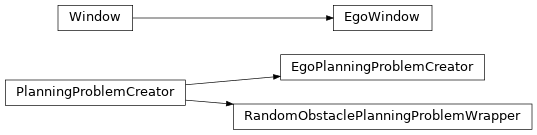
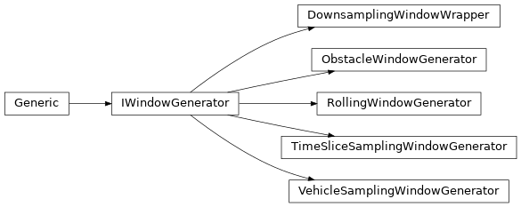

## Factory
::: crdata.conversion.tabular.factory

## Filters
::: crdata.conversion.tabular.filters

## Interface
::: crdata.conversion.tabular.interface

## Job Consumer
::: crdata.conversion.tabular.job_consumer

## Job Producer
::: crdata.conversion.tabular.job_producer

## Planning Problem

::: crdata.conversion.tabular.planning_problem

## Prototype Scenario
::: crdata.conversion.tabular.prototype_scenario

## Windowing

::: crdata.conversion.tabular.windowing
